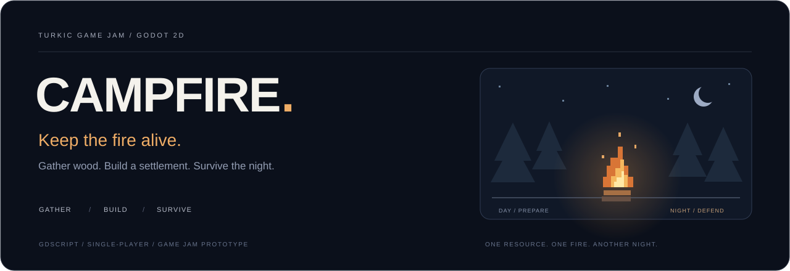

  

<a href="README.md">Русский</a> · <strong>English</strong>

<h1 align="center">Campfire</h1>

  <strong>Keep the fire alive.</strong> 
  A 2D survival and settlement-management prototype for Turkic Game Jam.

  
  
  
  

  <a href="#about">About</a> ·
  <a href="#game-loop">Game loop</a> ·
  <a href="#controls">Controls</a> ·
  <a href="#project-structure">Project</a> ·
  <a href="#contributors">Contributors</a>

---

## About

A campfire burns at the center of the world. Its fuel steadily runs out, while enemies emerge from the surrounding forest at night. Gather wood, recruit settlers and strengthen the settlement to survive another night.

**Wood is the only resource:** it fuels the fire, pays for construction and recruits new settlers. Every investment in growth competes with the fuel supply. When the fire goes out, the game ends.

## Game loop

| Day — prepare | Night — defend |
| --- | --- |
| Chop trees and collect wood. | Survive waves of wolves and bears. |
| Refill the campfire. | Keep the fire burning while defenders hold the perimeter. |
| Recruit settlers and construct buildings. | Watch the walls and manage the remaining resources. |
| Expand wood production and improve defenses. | Reach dawn and prepare for a stronger wave. |

### Implemented in the prototype

- **Campfire:** fuel consumption, flickering light, fire particles and a game-over state when it burns out.
- **Day and night:** gradual lighting transitions and increasingly difficult enemy waves.
- **Resource gathering:** tree chopping, dropped logs and limited carrying capacity.
- **Settlers:** recruit vagrants and assign professions through buildings.
- **Lumberjack house:** automated wood collection and storage.
- **Barracks:** spearmen to defend the settlement.
- **Walls:** construction, repairs and three upgrade levels, including spikes.

## Controls

| Input | Action |
| --- | --- |
| `A` / `D` or `←` / `→` | Move. |
| `W`, `↑` or `Space` | Jump. |
| `E` or left mouse button | Interact with a nearby object: chop, refuel, build or recruit. |
| `R` | Restart after game over. |

## Project structure

Built with **Godot 4.6**, **GDScript** and **2D scenes**. Game objects have their own scenes and scripts; signals carry events, and Godot groups connect nearby objects.

| File or directory | Responsibility |
| --- | --- |
| [`project.godot`](project.godot) | Godot project and main scene. |
| [`scenes/main/`](scenes/main/) | Day/night cycle, forests, settlers and enemy waves. |
| [`scenes/player/`](scenes/player/) | Movement, carrying wood and interactions. |
| [`scenes/campfire/`](scenes/campfire/) | Fuel, lighting and game-over events. |
| [`scenes/buildings/`](scenes/buildings/) | Lumberjack house, barracks and walls. |
| [`scenes/units/`](scenes/units/) | Lumberjack and spearman behavior. |
| [`scenes/enemy/`](scenes/enemy/) | Wolves and bears. |
| [`assets/shaders/`](assets/shaders/) | Environment shaders. |

### Development documents

- [Original design document](README_campfire_game.md) — concept and target mechanics, in Russian.
- [Visual design brief](designer_brief.md) — atmosphere, characters and environment, in Russian.
- [Implementation plan](implementation_plan.md) — development notes, in Russian.

The design document also includes planned mechanics. The prototype description above has been checked against the current scripts.

## Contributors

[Kyrsadak](https://github.com/Kyrsadak) · [fluxo159](https://github.com/fluxo159)

---

  Gather wood. Grow the settlement. Protect the fire. 
  <a href="README.md">Читать на русском</a> · <a href="#campfire">Back to top ↑</a>

