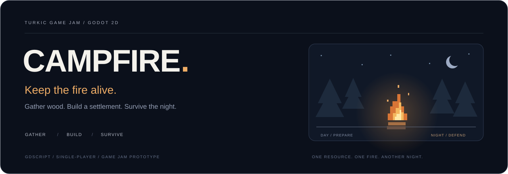

  

<strong>Русский</strong> · <a href="README.en.md">English</a>

<h1 align="center">Campfire</h1>

  <strong>Пока горит костёр — живёт поселение.</strong> 
  2D-прототип выживания и управления поселением для Turkic Game Jam.

  
  
  
  

  <a href="#об-игре">Об игре</a> ·
  <a href="#игровой-цикл">Игровой цикл</a> ·
  <a href="#управление">Управление</a> ·
  <a href="#внутри-проекта">Проект</a> ·
  <a href="#участники">Участники</a>

---

## Об игре

В центре мира горит костёр. Он постоянно расходует топливо, а вокруг простирается лес, из которого ночью приходят враги. Игрок собирает дрова, нанимает жителей и укрепляет поселение, чтобы пережить следующую ночь.

**Дрова — единственный ресурс:** они нужны и огню, и строительству, и найму. Чем больше вы вкладываете в развитие, тем внимательнее нужно следить за запасом топлива. Когда костёр гаснет, игра заканчивается.

## Игровой цикл

| Днём — подготовка | Ночью — оборона |
| --- | --- |
| Рубить деревья и собирать дрова. | Переживать волны волков и медведей. |
| Пополнять топливо костра. | Поддерживать огонь, пока защитники сдерживают врагов. |
| Нанимать жителей и строить здания. | Следить за состоянием стен и запасом ресурсов. |
| Развивать добычу и укреплять периметр. | Дожить до рассвета и подготовиться к более сильной волне. |

### Что реализовано в прототипе

- **Костёр:** запас топлива, мерцание света, частицы огня и поражение при затухании.
- **День и ночь:** плавная смена освещения и усиливающиеся волны врагов.
- **Сбор ресурсов:** рубка деревьев, выпадающие дрова и ограниченная переносимая стопка.
- **Жители:** найм бродяг и назначение профессий через здания.
- **Дом лесоруба:** автоматическая заготовка дров и хранилище.
- **Казарма:** копейщики для защиты поселения.
- **Стены:** строительство, ремонт и три уровня улучшения, включая защиту с шипами.

## Управление

| Клавиша | Действие |
| --- | --- |
| `A` / `D` или `←` / `→` | Движение. |
| `W`, `↑` или `Space` | Прыжок. |
| `E` или левая кнопка мыши | Взаимодействие с ближайшим объектом: рубка, топливо, строительство или найм. |
| `R` | Перезапуск после окончания игры. |

## Внутри проекта

Проект использует **Godot 4.6**, **GDScript** и сцены **2D**. Игровые объекты разделены на собственные сцены и скрипты; события передаются через сигналы, а объекты находят друг друга через группы Godot.

| Файл или папка | Назначение |
| --- | --- |
| [`project.godot`](project.godot) | Проект Godot и главная сцена. |
| [`scenes/main/`](scenes/main/) | День и ночь, лес, появление жителей и волны врагов. |
| [`scenes/player/`](scenes/player/) | Движение, переноска дров и взаимодействия. |
| [`scenes/campfire/`](scenes/campfire/) | Топливо, свет и завершение игры. |
| [`scenes/buildings/`](scenes/buildings/) | Дом лесоруба, казарма и стены. |
| [`scenes/units/`](scenes/units/) | Поведение лесорубов и копейщиков. |
| [`scenes/enemy/`](scenes/enemy/) | Волки и медведи. |
| [`assets/shaders/`](assets/shaders/) | Шейдеры окружения. |

### Материалы разработки

- [Исходный дизайн-документ](README_campfire_game.md) — концепция и целевые механики.
- [Бриф по визуальному стилю](designer_brief.md) — атмосфера, персонажи и окружение.
- [План реализации](implementation_plan.md) — рабочие заметки по разработке.

Дизайн-документ содержит и задуманные механики. Описание прототипа выше сверено с текущими скриптами проекта.

## Участники

[Kyrsadak](https://github.com/Kyrsadak) · [fluxo159](https://github.com/fluxo159)

---

  Собирай дрова. Развивай поселение. Сохрани огонь. 
  <a href="README.en.md">Read in English</a> · <a href="#campfire">Наверх ↑</a>

